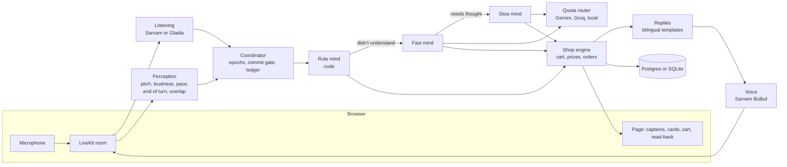

# How Ala is built, and why

The assignment says the voice must sound calm, handle interruptions and corrections, and confirm orders properly. It will be
judged live with hidden instructions. So the design starts from what goes wrong in a real call:

- A customer corrects themselves, and the first number has already reached the cart.
- A model invents a price, or a discount it was talked into.
- "Yes" arrives, but it was an answer to a different question, or the customer never heard the read-back.
- "Mm-hmm" or a TV in the room stops Ala mid-sentence.
- A free model hits its limit in the middle of the demo.

Each of these has a piece of code whose only job is to prevent it. Language models do what they're good at, which is
understanding what someone means. They don't hold the cart, the prices or the decision to place an order.

## The parts



## One turn

The customer says *"half a kilo of prawns, no wait, make it one kilo"* while Ala is still talking.

1. **Overlap.** `perception/overlap.py` decides what the overlapping speech is: an interruption, a backchannel ("mm"), side
   talk, background, Ala's own echo or noise. This one has shop words in it, so it's an interruption and Ala stops. How much of
   its sentence the customer heard is noted, so it doesn't claim to have said the rest.
2. **Waiting.** The coordinator starts a new epoch, which voids anything planned from older words. The self-correction ("no wait")
   stretches the hold to 1.8 s. If the customer keeps talking, nothing commits.
3. **Rule mind.** `minds/rules.py` reads the sentence, including the correction, and plans `set_item(prawns, 1 kg)`. No model is
   called, so this turn costs nothing and takes milliseconds.
4. **Commit gate.** The plan waits out its hold. New words void it, so the pre-correction value can't reach the cart. The ledger
   makes sure an action runs once even if a turn is re-read.
5. **Reply.** The engine returns a result and a template gives the words, with the price from the catalog. `speakable()` turns
   "₹700" into words a voice reads correctly, in the language the customer is using.

## Three minds, cheapest first

| Mind | Handles | Cost | Time |
| --- | --- | --- | --- |
| Rule mind (code) | Clear commands in English, Telugu and mixed speech: quantities, corrections, cart questions, yes and no, stop, repeat | Nothing | Milliseconds |
| Fast mind (small model) | Anything the rules don't understand: vague requests, odd phrasing, questions about products | One request | About a second, to be measured |
| Slow mind (larger model) | Meal planning, trade-offs, comparisons with reasons | One request | Seconds, with a spoken bridge first |

A model returns one JSON object per turn, not a tool-calling loop:

```json
{"actions": [{"name": "set_item", "args": {"item": "prawns", "qty": 1, "unit": "kg"}}], "say": "", "listen": false, "consult": false}
```

The actions are checked against `MODEL_ACTIONS` and run through the same engine as the rules. When an action has a confirmation,
the engine's template speaks, not the model. When a model writes its own sentence, any number in it that didn't come from the
catalog or the conversation is removed (`drop_invented_numbers`).

## The order is code's decision

`place_order` isn't in `MODEL_ACTIONS`, so no model output can reach it, whatever it's told. An order needs all of these:

- a read-back of the exact cart, recorded with a hash of what it described;
- the customer having heard that read-back to the end, or having seen it on the sheet if they typed or tapped;
- a clear yes to that question, from code that recognises yes in both languages;
- a cart that still matches the hash. Any edit after the read-back means a new read-back.

## The coordinator

The coordinator comes from DUET, where it scored 0.88 on Full-Duplex-Bench v3's self-corrections. It answers one question:
*is Ala allowed to act yet?*

- **Epochs** void plans made on words the customer may be changing. Speech with no words, like a cough, leaves them standing.
- **The commit gate** holds every change until the customer has been quiet long enough.
- **The ledger** answers a repeated action from memory.

Holds depend on what's at stake: 0.8 s for a cart edit, 1.4 s for an order, 1.8 s when the customer is revising, 2.2 s when a
sentence is left hanging. The holds are starting values until they're tuned on real recordings.

## Semantics and acoustics

This extends DUET's idea that words and voice each know something the other doesn't.

**Acoustics.** `perception/features.py` measures pitch (YIN, in numpy), loudness, pace and pauses for each stretch of speech.
`reading.py` compares them with *this* speaker's own baseline, since a loud voice for one person is normal for another. From
that it reads urgent, frustrated, unsure and raised. Those readings change behaviour in small ways: shorter replies when someone
is in a hurry, a repair when they're frustrated, a check when they sound unsure.

**End of turn.** Smart Turn v3.2, a small ONNX model pinned by revision and checksum, listens for whether the voice sounds
finished. It runs locally on the CPU.

**The rule that ties them together:** the voice decides *when*, words decide *what it means*, and words only ever delay.
A sentence ending in "and" or "of" stretches the wait. Nothing in the words shortens it, so a misheard word can make Ala slower
but can't make it cut someone off. There are two exceptions: stop words act at once, and a short answer to Ala's own question
doesn't need to sound finished.

## Telugu and English

- `language/numbers.py` reads quantities and money in both languages, including *అర కిలో* and *పావు కిలో*, and writes them back as
  speech.
- `language/detect.py` follows the language of each turn. A word or two of English inside Telugu doesn't flip it, a real switch
  does, and "speak only Telugu" pins it.
- Every reply in `shop/replies.py` exists in both languages, written rather than machine-translated.
- Product names keep their local form (*vanjaram*, *chanduva*), and listening is given the catalog as a vocabulary.

## Free quotas

`minds/router.py` tracks requests and tokens per minute and per day for each provider. It skips a provider that's near a limit,
rests one that returns 429, stops using one that refuses the key, and starts a backup request if the first is slow. A turn only
reaches it after the rule mind has passed, so most of a shopping call uses no quota. If everything is busy, Ala says so briefly
and the rule mind keeps working, so the cart still works when no model is available.

Limits are counted per account, so we don't open extra accounts to multiply them.

## Decisions

| Decision | Why | What it costs |
| --- | --- | --- |
| A cascade (listen, think, speak), not speech-to-speech | Telugu quality, exact prices and hard rules around orders need a text step we control | About a second more latency, and tone isn't carried through except by perception |
| LiveKit Agents | Handles WebRTC, barge-in and turn-taking, has free hosting in Mumbai, and DUET already proved it | Hooks into its internals (`stt_node`, `llm_node`, `tts_node`) need care on upgrades |
| Rules before models | Free and instant, and the common turns are the ones that must never fail | Rules need maintenance, and they can misread what a model wouldn't |
| One JSON response per turn | One round trip instead of a loop, and half the quota | No multi-step tool use within a turn. The engine does that work instead |
| Replies from templates | A model can't invent a price, and the tone stays calm | Less variety, reduced by `polish()`, which avoids repeating itself |
| LiveKit Cloud and Vercel, not Render | Render's free tier sleeps after 15 minutes and its 0.1 CPU can't carry live audio. This split is free and stops at its limits | A 10 to 20 second wake-up after a quiet spell |
| Own palette, inspired by Shopify | Polaris's licence covers apps that integrate with Shopify | We wrote our own small stylesheet |
| Phone channel left out | The assignment asks for a web link, and telephony isn't free | Described here as the next step, not built |

## Known limits

- **Not yet proven with real speech.** See [EVALUATION.md](EVALUATION.md). Thresholds, holds and voice choice are starting values.
- **Memory is keyed by first name**, so two people called Ravi share a profile. That's fine for a demo and wrong for a product,
  where it would be a phone number.
- **Stock and sellers are simulated.** The catalog is a realistic sample, and delivery and payment are pretend.
- **Cold start.** The first call after a quiet spell waits 10 to 20 seconds on the free plan.
- **Free services may keep what they receive.** The page says so.

## What comes next

KREEV's name points to low-data, voice-first users, so the natural next channel is a phone number. The agent would stay the same,
because LiveKit SIP joins a call to the same kind of room, though audio at 8 kHz would need its own listening tests. After that
comes a seller side: stock updates by voice, in Telugu.
